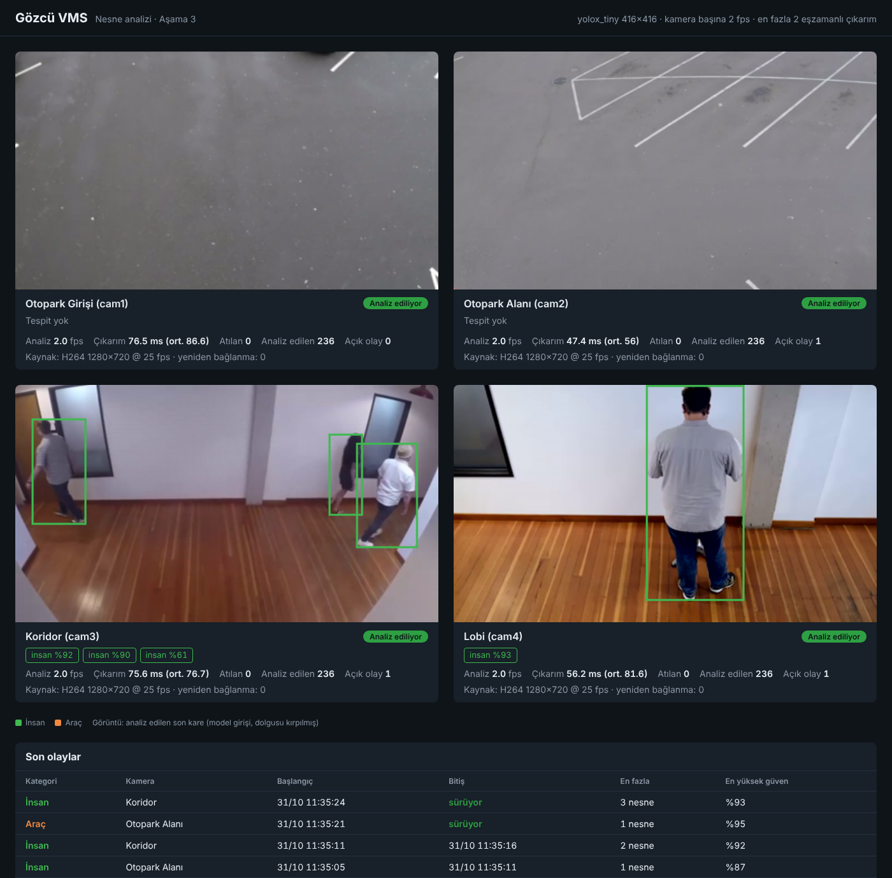
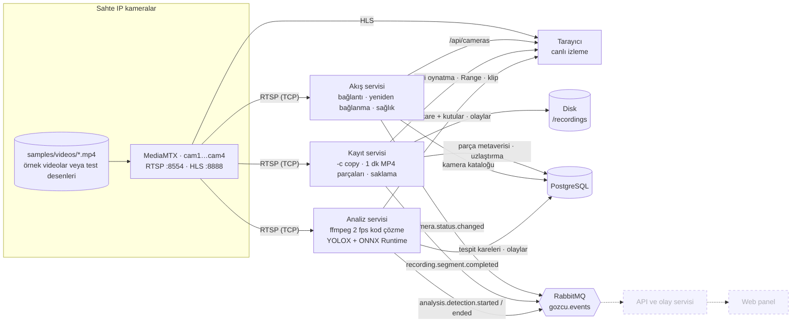

# Gözcü VMS – Video Analiz ve Kayıt Sunucusu

[](https://github.com/mustafagulturk/gozcu-vms/actions/workflows/ci.yml)


Birden fazla IP kameradan RTSP akışı alan, yeniden kodlamadan kaydeden, görüntüde insan ve araç tespit eden
ve olayları web panelde gösteren mikroservis tabanlı bir video yönetim sistemi (VMS).
Gerçek kamera gerektirmez: video dosyaları MediaMTX ile sahte RTSP kameralar olarak yayınlanır; testler ve CI da bu
sahte kameralarla çalışır.

> **Durum:** 3. aşama tamamlandı (YOLOX + ONNX Runtime ile insan ve araç tespiti). Yol haritası aşağıda.




## English summary

Gözcü ("watchman") is a microservice-based video management system written in C# / .NET 8. It ingests RTSP streams
from IP cameras, records them to disk in one-minute MP4 segments **without re-encoding** (FFmpeg stream copy), tracks
camera health with automatic reconnection and exponential backoff, and publishes domain events over RabbitMQ with
segment metadata stored in PostgreSQL. Recordings can be played back by wall-clock time in the browser (timeline with gaps,
seamless segment-to-segment playback over HTTP range requests) and exported as clips with the FFmpeg concat demuxer, again
without re-encoding. On startup the recorder reconciles disk and database: segments cut off by a crash are detected with
ffprobe and quarantined, and finished segments missing from the index are recovered. A separate analysis service is the
only component that decodes video: it samples a few frames per second per camera with FFmpeg (letterboxed to the model
input), runs YOLOX object detection with ONNX Runtime in-process, stores per-frame detections as JSONB metadata in
PostgreSQL and turns them into debounced person/vehicle events published on RabbitMQ. Back-pressure is handled with a
drop-oldest channel so inference always works on the freshest frame. Upcoming phases add event search and a web dashboard. Fake cameras are served by MediaMTX, so the whole system, its integration tests and CI
run without real hardware. `docker compose up --build` starts everything.

## Mimari



Kesikli kutular sonraki aşamalarda eklenecek servislerdir.

| Bileşen | Sorumluluk |
|---|---|
| `Gozcu.StreamingService` | Her kamera için akışı çözmeden okuyan bir ffmpeg süreci çalıştırır. Akışın gerçek zamanlı gelip gelmediğini ölçer (`Connecting → Online → Degraded → Offline`), bağlantı koparsa üstel geri çekilmeyle yeniden bağlanır, durum değişikliklerini RabbitMQ'ya yayınlar. Canlı izleme sayfasını ve `/api/cameras` uç noktasını sunar. |
| `Gozcu.RecordingService` | ffmpeg segment muxer ile akışı **yeniden kodlamadan** saat sınırlarına hizalı MP4 parçalarına yazar. Biten her parçayı PostgreSQL'e kaydeder ve olay yayınlar. Kota aşıldığında veya disk dolmak üzereyken en eski parçaları siler. Geri oynatma sayfasını, zaman çizelgesi / parça akışı / klip dışa aktarma API'sini sunar. Açılışta disk ile veritabanını uzlaştırır. |
| `Gozcu.AnalysisService` | Sistemde videoyu **çözen tek** servis. Her kamera için ffmpeg'i saniyede 2 kare, model boyutunda (416×416, letterbox) ham BGR çıktı verecek şekilde çalıştırır. Kareler kapasitesi 1 olan "en eskiyi at" kanalından çıkarıma gider, böylece gecikme birikmez. Tespitleri PostgreSQL'e JSONB olarak toplu yazar, art arda karelerden insan/araç **olayları** üretip RabbitMQ'ya yayınlar. Analiz sayfasını ve tespit/olay API'sini sunar. |
| `Gozcu.Vision` | ONNX Runtime ile YOLOX çıkarımı: BGR → CHW tensör, ızgara/adım (grid/stride) kod çözme, sınıf bazında NMS, COCO sınıflarını insan/araç kategorilerine eşleme, kutuları kaynak görüntüye göre 0..1 aralığına normalize etme. ASP.NET'e bağımlı değildir. |
| `Gozcu.Media` | ffmpeg süreç denetleyicisi (yeniden başlatma, nazik durdurma), komut üreticileri (kayıt, izleme, concat ile klip), ffprobe ile medya doğrulama ve çıktı ayrıştırıcıları. |
| `Gozcu.Infrastructure` | PostgreSQL (Dapper, gömülü SQL betikleriyle şema yönetimi) ve RabbitMQ (topic exchange) erişimi. |
| `Gozcu.Contracts` | Servisler arası olaylar ve kamera tanımları. |

### Tasarım kararları

- **Yeniden kodlama yok.** Kayıt ve izleme `-c copy` ile yapılır; kamera başına CPU kullanımı %1'in altındadır.
  Kod çözme yalnızca 3. aşamadaki analiz servisinde, saniyede birkaç kare için yapılacak.
- **Saate hizalı parçalar.** `-segment_atclocktime` ile her parça dakikanın başında başlar ve dosya adı UTC başlangıç
  zamanını taşır (`cam1_20261028T171500Z.mp4`). Böylece saate göre geri oynatma basit bir aralık sorgusudur ve
  veritabanı olmadan da dosyalar sıralanabilir.
- **Kayıt veritabanını beklemez.** PostgreSQL veya RabbitMQ erişilemezken de diske kayıt sürer; parçalar kuyrukta bekler
  ve bağlantı gelince indekslenir. Saklama politikası kaynak olarak dosya sistemini kullanır, böylece disk yine dolmaz.
- **Nazik durdurma.** Süreçler kapatılırken ffmpeg'e `q` gönderilir; son parçanın MP4 başlığı yazılır ve dosya bozulmaz.
- **Geri oynatma tarayıcıda parça parça.** MP4 parçaları HLS'e çevrilmez; tarayıcı her parçayı HTTP Range ile doğrudan
  açar. İki `<video>` öğesiyle bir sonraki parça önceden yüklenir ve `ended` olayında yer değiştirilir, böylece parça
  geçişleri fark edilmez. Kayıt olmayan aralıklar zaman çizelgesinde boşluk olarak gösterilir ve oynatma sırasında atlanır.
  Duvar saati = parçanın başlangıç zamanı + `currentTime`.
- **Klip de yeniden kodlanmaz.** Dışa aktarma ffmpeg concat demuxer'ına `inpoint`/`outpoint` içeren bir liste verir
  (`-c copy -movflags +faststart`). Bedeli: klip istenen andan önceki anahtar kareden başlar (en fazla bir GOP, ~2 sn).
  Medya dosyası yolları veritabanından gelse bile kayıt kökü dışına çıkamaz (yol geçişi denetimi).
- **Açılış uzlaştırması.** Servis aniden kesilirse yazılmakta olan parçanın `moov` kutusu yazılmaz ve dosya büyük ama
  oynatılamaz kalır; bellekteki indeksleme kuyruğu da kaybolur. Kayıt süreçleri başlamadan önce diskteki dosyaların
  listesi alınır; veritabanında olmayan ya da boyutu farklı olanlar ffprobe ile doğrulanır. Oynatılabilenler indekslenir ve
  olayları yayınlanır, bozuklar `_quarantine/` altına taşınır, dosyası kaybolmuş kayıtlar silindi olarak işaretlenir.
  Sonuç `/api/recordings/reconciliation` adresinden okunur. İşlem idempotenttir; ikinci çalıştırma hiçbir şey değiştirmez.
- **Tek yerde kod çözme, az kare.** Kayıt ve izleme kodlanmış paketlerle çalışır; yalnızca analiz servisi çözer ve
  ffmpeg'in `fps=2` süzgeciyle saniyede 2 kare modele gider. Ölçekleme ve gri dolgu (letterbox) da ffmpeg'de, C ile yapılır;
  .NET tarafı yalnızca baytları tensöre çevirir.
- **Model lisansı bilinçli seçildi.** Ultralytics YOLOv8/11 AGPL-3.0 lisanslıdır; YOLOX (Megvii) Apache-2.0'dır ve MIT
  lisanslı bir projede, kapalı kaynak savunma ürünlerinde sorunsuz kullanılabilir. Model imaja derleme sırasında indirilir
  ve SHA-256 ile doğrulanır (`scripts/download-model.sh`).
- **Geri basınç: en taze kare.** Okuyucu ile çıkarım arasındaki kanal 1 kapasiteli ve `DropOldest` kipindedir. Çıkarım
  yavaşlarsa eski kare atılır ve sayılır; kuyruk ve gecikme büyümez. Tüm kameralar için eşzamanlı çıkarım sayısı da
  sınırlıdır (`Analysis__MaxConcurrentInferences`).
- **Kare değil olay.** Her kare tek başına gürültülüdür. Bir kategori art arda en az 2 karede %50 üzeri güvenle görülünce
  olay açılır, 5 sn görülmezse kapanır (`analysis.detection.started` / `ended`). Tespitlerin kendisi kare kare JSONB
  olarak saklanır (boş kareler yazılmaz); 4. aşamadaki zaman çizelgesi işaretleri ve olay araması bunları kullanacak.
- **Test edilebilir zaman.** Sağlık durum makinesi ve yeniden bağlanma denetleyicisi .NET 8 `TimeProvider` kullanır;
  birim testleri `FakeTimeProvider` ile gerçek beklemeden çalışır.

## Hızlı başlangıç

Gereksinimler: Docker (Compose v2). Geliştirme için ayrıca .NET 8 SDK ve ffmpeg.

```bash
git clone https://github.com/mustafagulturk/gozcu-vms.git
cd gozcu-vms

# (İsteğe bağlı ama önerilir) Gerçek güvenlik kamerası görüntüleri: 4 örnek videoyu indirip hazırlar
# (Intel IoT DevKit, CC BY 4.0). Bu adımı atlarsan her kamera kendi test desenini yayınlar.
./scripts/download-sample-videos.sh
# Kendi videonu kullanmak istersen: ./scripts/prepare-video.sh ~/Downloads/trafik.mp4 cam1

docker compose up --build
```

| Adres | Ne var |
|---|---|
| <http://localhost:5080> | Canlı izleme sayfası (4 kamera, durum + HLS oynatıcı) |
| <http://localhost:5081> | Geri oynatma sayfası (zaman çizelgesi, saate göre oynatma, klip indirme) |
| <http://localhost:5081/api/playback/cam1/timeline> | Son bir saatin kayıtları, boşlukları ve kapsama aralıkları |
| `http://localhost:5081/api/playback/cam1/export?from=…&to=…` | Yeniden kodlamasız MP4 klip (en fazla 1 saat) |
| <http://localhost:5081/api/recordings/reconciliation> | Açılış uzlaştırması raporu |
| <http://localhost:5082> | Analiz sayfası (son analiz edilen kare + tespit kutuları, sayaçlar, son olaylar) |
| <http://localhost:5082/api/analysis/events?category=Person> | İnsan/araç olayları (`cameraId`, `category`, `from`, `to`) |
| <http://localhost:5082/api/analysis/detections?cameraId=cam3> | Kare kare tespit metaverisi (normalize kutular) |
| <http://localhost:5082/api/analysis/status> | Model, kamera başına analiz FPS'i, çıkarım süresi, atılan kare |
| <http://localhost:5080/api/cameras> | Kamera sağlık durumu |
| <http://localhost:5081/api/recordings/status> | Kayıt durumu ve kayıt gecikmesi ölçümleri |
| <http://localhost:5081/api/recordings/segments?cameraId=cam1&from=2026-10-28T10:00:00Z&to=2026-10-28T11:00:00Z> | Saate göre kayıt parçası arama |
| <http://localhost:15672> | RabbitMQ yönetim arayüzü (`gozcu` / `gozcu`) |
| `rtsp://localhost:8554/cam1` | Sahte kamera (VLC ile açılabilir) |

Kayıtlar `recordings` Docker biriminde tutulur. Parça süresi ve saklama sınırları ortam değişkenleriyle değiştirilebilir:

```bash
SEGMENT_SECONDS=10 RETENTION_MAX_BYTES=2147483648 docker compose up --build
```

Analiz hızı da öyle: `ANALYSIS_FPS=5 ANALYSIS_MAX_CONCURRENCY=4 docker compose up --build`. Farklı bir model için
`docker compose build --build-arg MODEL=yolox_s analysis` (yolox_nano | yolox_tiny | yolox_s).

Uçtan uca doğrulama (CI'daki duman testiyle aynı):

```bash
SEGMENT_SECONDS=10 docker compose up -d --build
./scripts/smoke-test.sh
```

## Geliştirme

```bash
./scripts/download-model.sh                # YOLOX-Tiny ONNX modelini models/ altına indirir (SHA-256 doğrulamalı)
dotnet build
dotnet test tests/Gozcu.UnitTests          # hızlı, harici bağımlılık yok
dotnet test tests/Gozcu.IntegrationTests   # Docker ve ffmpeg gerekir (Testcontainers)
```

Servisleri IDE'den çalıştırmak için altyapıyı Compose ile başlatıp servisleri yerelde çalıştırabilirsin:

```bash
docker compose up -d mediamtx postgres rabbitmq
dotnet run --project src/Gozcu.StreamingService   # http://localhost:5080
dotnet run --project src/Gozcu.RecordingService   # http://localhost:5081
dotnet run --project src/Gozcu.AnalysisService    # http://localhost:5082 (models/yolox_tiny.onnx gerekir)
```

### Testler

| Proje | Kapsam |
|---|---|
| `Gozcu.UnitTests` | Yeniden bağlanma politikası, ffmpeg komutları ve çıktı ayrıştırıcıları, süreç denetleyicisi, kamera sağlık durum makinesi, kayıt parçası işleme, saklama planlayıcısı, yapılandırma doğrulaması; geri oynatma zaman çizelgesi ve konum bulma, klip planlayıcı, concat listesi kaçışları, yol geçişi denetimi; uzlaştırma planlayıcısı, karantina ve ffprobe çıktısı; letterbox geometrisi, YOLOX çıktı kod çözme (elle kurulmuş tensörlerle), NMS, BGR→CHW tensör, ham kare okuyucu, olay takipçisi (debounce, boşlukla kapanma), BMP yazıcı, analiz döngüsü (en eskiyi atma, yeniden bağlanma, eşzamanlılık sınırı) |
| `Gozcu.IntegrationTests` | Gerçek MediaMTX konteyneri ve ffmpeg ile: kamera kopup geri geldiğinde otomatik yeniden bağlanma; yeniden kodlamasız, saate hizalı, oynatılabilir parça kaydı. PostgreSQL ile şema betikleri ve saate göre arama; RabbitMQ ile olay yayını ve yönlendirme. Parçalardan yeniden kodlamasız klip üretimi. SIGKILL ile yarıda kesilmiş MP4'ün ffprobe ile tespiti ve PostgreSQL ile uçtan uca uzlaştırma. Gerçek YOLOX modeliyle örnek karede araç, insan ve bisiklet tespiti; paralel çıkarımda aynı sonuç. RTSP → ffmpeg → kare → tespit → PostgreSQL + RabbitMQ olayları |
| `scripts/smoke-test.sh` | Docker Compose ile tüm sistem: 4 kamera çevrimiçi, HLS yayınları, parçaların diske ve veritabanına yazılması, zaman çizelgesi, HTTP Range ile parça akışı, klip dışa aktarma, kayıt servisini SIGKILL ile öldürüp açılış uzlaştırmasını doğrulama; 4 kameranın analiz edildiği, örnek videolarda insan ve araç olaylarının oluşup RabbitMQ'ya yayınlandığı |

## Ölçümler

2. aşama, 4 kamera (2× 1280x720 25 fps, 960x540 15 fps, 640x360 25 fps H.264), Docker üzerinde, 4 vCPU:

| Ölçüm | 1 kamera (1. aşama) | 4 kamera |
|---|---|---|
| Akış servisi CPU / bellek | %0,6 / 87 MiB | %2,8 / 95 MiB |
| Kayıt servisi CPU / bellek | %0,6 / 114 MiB | %2,4 / 114 MiB |
| Kayıt gecikmesi (parça bitişi → veritabanında aranabilir) | ort. 170 ms, en çok 250 ms | ort. 131 ms, en çok 185 ms |
| Kamera kopmasından sonra yeniden bağlanma | 1–2 sn (ilk deneme) | 1–2 sn |
| 1 saatlik zaman çizelgesi sorgusu | – | 12 ms |
| 60 sn'lik klip dışa aktarma (yeniden kodlamasız) | – | 156 ms |
| SIGKILL sonrası açılış uzlaştırması | – | 309 ms (16 dosya; 2 karantina) |

3. aşama, nesne tespiti: 4 kamera (Intel örnek videoları, 1280x720 25 fps), kamera başına 2 fps, YOLOX-Tiny 416×416,
Docker üzerinde, 4 vCPU, GPU yok:

| Ölçüm | Değer |
|---|---|
| Toplam tespit hızı | 8 kare/sn (4 kamera × 2,0 fps), atılan kare 0 |
| Çıkarım süresi (ön ve son işleme dahil) | tek başına 42 ms; 4 kamera yükte ort. 65–90 ms |
| Model karşılaştırması (tek çıkarım, 4 iş parçacığı) | nano 16 ms · tiny 42 ms · s 112 ms |
| Analiz servisi CPU / bellek | %148 / 389 MiB (kamera başına ffmpeg kod çözme ≈ %8, kalanı çıkarım) |
| Örnek karede güven (araç / insan / bisiklet) | tiny: 0,92 / 0,65 / 0,65 · s: 0,94 / 0,73 / 0,89 · nano: 0,91 / – / – |

Eşzamanlı kamera sayısı üst sınırı 5. aşamada ölçülecek. (Sahte kamera tarafındaki MediaMTX CPU
kullanımı test desenlerinin anlık kodlanmasından kaynaklanır; hazırlanmış video dosyasıyla yayın kopyalama modundadır.)

## Yol haritası

- [x] **1. Tek kamera canlı izleme ve kayıt** – RTSP bağlantısı, otomatik yeniden bağlanma, sağlık durumu, yeniden kodlamasız 1 dk parçalar, saklama politikası, Docker Compose, CI
- [x] **2. Çoklu kamera ve geri oynatma** – 4 sahte kamera, saate göre geri oynatma ve zaman çizelgesi, yeniden kodlamasız klip dışa aktarma, açılışta disk/veritabanı uzlaştırması
- [x] **3. Nesne tespiti** – saniyede 2 kare ile YOLOX (ONNX Runtime), insan/araç tespiti, kare kare metaveri (JSONB), olaylar (PostgreSQL + RabbitMQ), analiz sayfası
- [ ] **4. Olay arama ve web panel** – kamera yönetimi API'si, olay arama, tespit kutuları, zaman çizelgesi
- [ ] **5. Ölçümler, testler ve dokümantasyon** – yük testleri, ölçüm tablosu, demo GIF

## Öğrenme notları

Her aşamanın arkasındaki kavramlar, tasarım kararları ve mülakat soruları:

- [Aşama 2: çoklu kamera ve geri oynatma](docs/asama-2-ogrenme-notu.md)
- [Aşama 3: nesne tespiti](docs/asama-3-ogrenme-notu.md)

## Lisans

MIT
