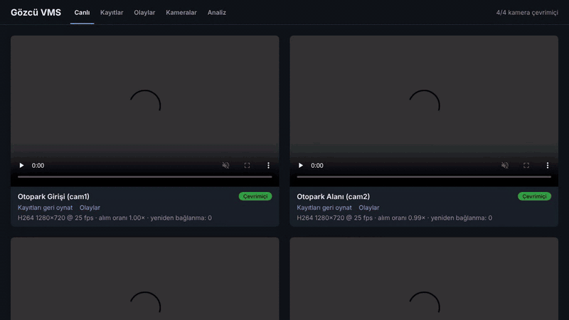
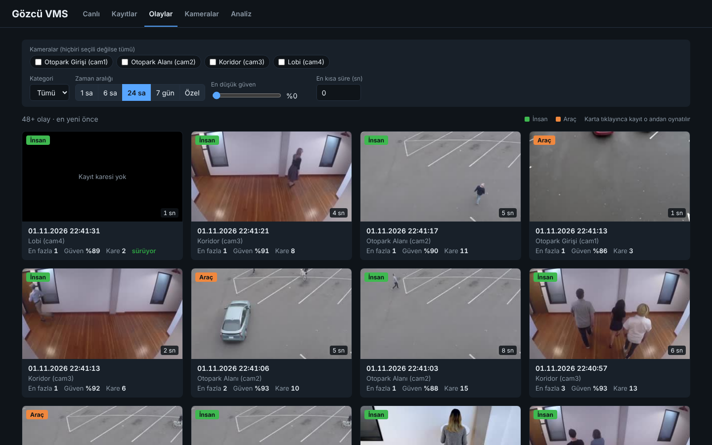
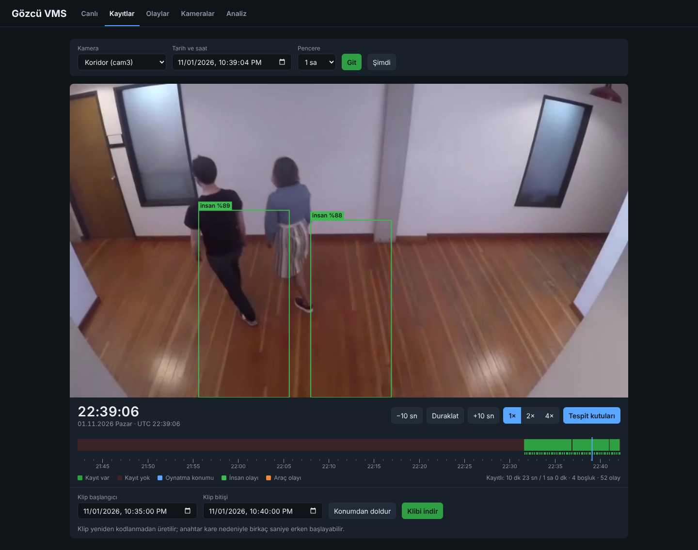
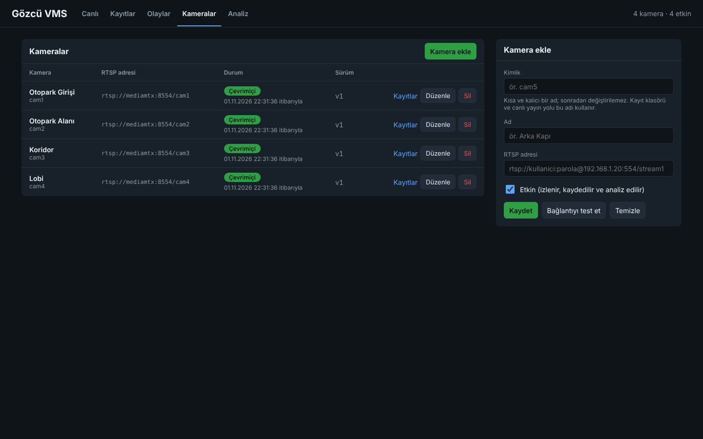
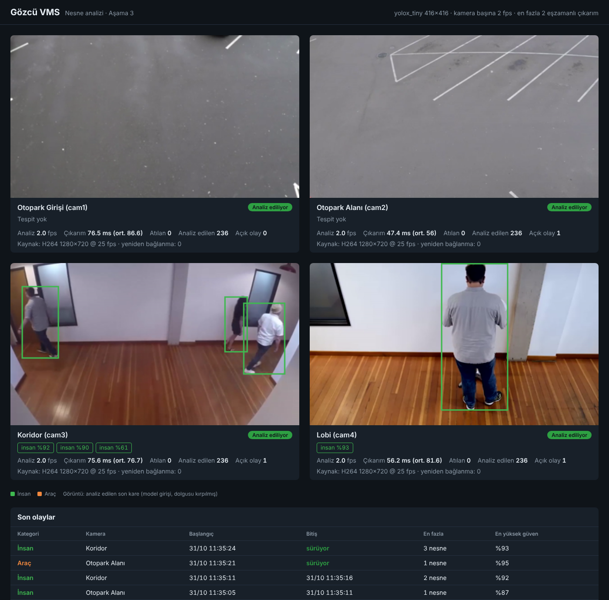
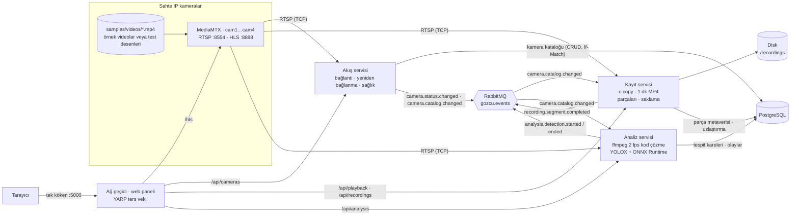

# Gözcü VMS – Video Analiz ve Kayıt Sunucusu

[](https://github.com/mustafagulturk/gozcu-vms/actions/workflows/ci.yml)


Birden fazla IP kameradan RTSP akışı alan, yeniden kodlamadan kaydeden, görüntüde insan ve araç tespit eden
ve olayları web panelde gösteren mikroservis tabanlı bir video yönetim sistemi (VMS).
Gerçek kamera gerektirmez: video dosyaları MediaMTX ile sahte RTSP kameralar olarak yayınlanır; testler ve CI da bu
sahte kameralarla çalışır.

> **Durum:** 5 aşamanın hepsi tamamlandı. Son aşamada yük testleri ve ölçümler eklendi: 4 vCPU'luk tek makinede tam sistem
> (kayıt + canlı izleme + 2 fps nesne tespiti) 8 kamera, yalnızca kayıt ve canlı izleme 64 kamera kaldırıyor. Ayrıntılar
> [Ölçümler](#ölçümler) bölümünde.











## English summary

Gözcü ("watchman") is a microservice-based video management system written in C# / .NET 8. It ingests RTSP streams
from IP cameras, records them to disk in one-minute MP4 segments **without re-encoding** (FFmpeg stream copy), tracks
camera health with automatic reconnection and exponential backoff, and publishes domain events over RabbitMQ with
segment metadata stored in PostgreSQL. Recordings can be played back by wall-clock time in the browser (timeline with gaps,
seamless segment-to-segment playback over HTTP range requests) and exported as clips with the FFmpeg concat demuxer, again
without re-encoding. On startup the recorder reconciles disk and database: segments cut off by a crash are detected with
ffprobe and quarantined, and finished segments missing from the index are recovered. A separate analysis service is the
only component that decodes video: it samples a few frames per second per camera with FFmpeg (letterboxed to the model
input), runs YOLOX object detection with ONNX Runtime in-process, stores per-frame detections as JSONB metadata in
PostgreSQL and turns them into debounced person/vehicle events published on RabbitMQ. Back-pressure is handled with a
drop-oldest channel so inference always works on the freshest frame. A YARP-based gateway serves a single-origin web dashboard (live view, playback with detection boxes drawn over the video and event markers on the timeline, event search with keyset pagination and thumbnails cut from the recordings, camera management). Cameras are managed through a REST API with optimistic concurrency (ETag / If-Match); the database is the source of truth and every service starts and stops its per-camera workers at runtime when the catalog changes (RabbitMQ signal plus periodic refresh). Capacity is measured, not guessed: a load-test script scales the number of cameras step by step (on 4 vCPUs the full
system handles 8 cameras at 2 fps detection, recording and live monitoring alone handle 64), a dependency-free HTTP load
generator reports latency percentiles in open and closed models (it found a connection-pool exhaustion bug), and
BenchmarkDotNet micro benchmarks cover the per-frame hot paths. Fake cameras are served by MediaMTX, so the whole system,
its integration tests and CI run without real hardware. `docker compose up --build` starts everything.

## Mimari



| Bileşen | Sorumluluk |
|---|---|
| `Gozcu.StreamingService` | Her kamera için akışı çözmeden okuyan bir ffmpeg süreci çalıştırır. Akışın gerçek zamanlı gelip gelmediğini ölçer (`Connecting → Online → Degraded → Offline`), bağlantı koparsa üstel geri çekilmeyle yeniden bağlanır, durum değişikliklerini RabbitMQ'ya yayınlar. Kamera kataloğunun sahibidir: `/api/cameras` CRUD API'si (ETag / If-Match, parola maskeleme, ffprobe ile bağlantı testi), ilk açılışta yapılandırmadan tek seferlik tohumlama, her değişiklikte `camera.catalog.changed`. |
| `Gozcu.RecordingService` | ffmpeg segment muxer ile akışı **yeniden kodlamadan** saat sınırlarına hizalı MP4 parçalarına yazar. Biten her parçayı PostgreSQL'e kaydeder ve olay yayınlar. Kota aşıldığında veya disk dolmak üzereyken en eski parçaları siler. Zaman çizelgesi / parça akışı / klip dışa aktarma / tek kare JPEG (`frame.jpg`) API'sini sunar. Açılışta disk ile veritabanını uzlaştırır. |
| `Gozcu.AnalysisService` | Sistemde videoyu **çözen tek** servis. Her kamera için ffmpeg'i saniyede 2 kare, model boyutunda (416×416, letterbox) ham BGR çıktı verecek şekilde çalıştırır. Kareler kapasitesi 1 olan "en eskiyi at" kanalından çıkarıma gider, böylece gecikme birikmez. Tespitleri PostgreSQL'e JSONB olarak toplu yazar, art arda karelerden insan/araç **olayları** üretip RabbitMQ'ya yayınlar. Tespit/olay API'sini ve keyset sayfalamalı olay aramasını sunar. |
| `Gozcu.Gateway` | Tarayıcının konuştuğu tek servis. Web panelini (Canlı, Kayıtlar, Olaylar, Kameralar, Analiz) statik dosya olarak sunar, `/api/**` ve `/hls/**` isteklerini YARP ile sahibi olan servise iletir. Tek köken olduğu için CORS gerekmez ve servis adresleri tarayıcıya sızmaz. |
| `Gozcu.Vision` | ONNX Runtime ile YOLOX çıkarımı: BGR → CHW tensör, ızgara/adım (grid/stride) kod çözme, sınıf bazında NMS, COCO sınıflarını insan/araç kategorilerine eşleme, kutuları kaynak görüntüye göre 0..1 aralığına normalize etme. ASP.NET'e bağımlı değildir. |
| `Gozcu.Media` | ffmpeg süreç denetleyicisi (yeniden başlatma, nazik durdurma), komut üreticileri (kayıt, izleme, concat ile klip), ffprobe ile medya doğrulama ve çıktı ayrıştırıcıları. |
| `Gozcu.Infrastructure` | PostgreSQL (Dapper, gömülü SQL betikleriyle şema yönetimi) ve RabbitMQ (topic exchange, yayın ve abonelik) erişimi. Kamera kataloğunun bellekteki kopyası (`CameraCatalog`) ve katalog değiştikçe kamera başına işleri başlatıp durduran `CameraWorkerHost`. |
| `Gozcu.Contracts` | Servisler arası olaylar ve kamera tanımları. |

### Tasarım kararları

- **Yeniden kodlama yok.** Kayıt ve izleme `-c copy` ile yapılır; kamera başına CPU kullanımı %1'in altındadır.
  Kod çözme yalnızca 3. aşamadaki analiz servisinde, saniyede birkaç kare için yapılacak.
- **Saate hizalı parçalar.** `-segment_atclocktime` ile her parça dakikanın başında başlar ve dosya adı UTC başlangıç
  zamanını taşır (`cam1_20261028T171500Z.mp4`). Böylece saate göre geri oynatma basit bir aralık sorgusudur ve
  veritabanı olmadan da dosyalar sıralanabilir.
- **Kayıt veritabanını beklemez.** PostgreSQL veya RabbitMQ erişilemezken de diske kayıt sürer; parçalar kuyrukta bekler
  ve bağlantı gelince indekslenir. Saklama politikası kaynak olarak dosya sistemini kullanır, böylece disk yine dolmaz.
- **Nazik durdurma.** Süreçler kapatılırken ffmpeg'e `q` gönderilir; son parçanın MP4 başlığı yazılır ve dosya bozulmaz.
- **Geri oynatma tarayıcıda parça parça.** MP4 parçaları HLS'e çevrilmez; tarayıcı her parçayı HTTP Range ile doğrudan
  açar. İki `<video>` öğesiyle bir sonraki parça önceden yüklenir ve `ended` olayında yer değiştirilir, böylece parça
  geçişleri fark edilmez. Kayıt olmayan aralıklar zaman çizelgesinde boşluk olarak gösterilir ve oynatma sırasında atlanır.
  Duvar saati = parçanın başlangıç zamanı + `currentTime`.
- **Klip de yeniden kodlanmaz.** Dışa aktarma ffmpeg concat demuxer'ına `inpoint`/`outpoint` içeren bir liste verir
  (`-c copy -movflags +faststart`). Bedeli: klip istenen andan önceki anahtar kareden başlar (en fazla bir GOP, ~2 sn).
  Medya dosyası yolları veritabanından gelse bile kayıt kökü dışına çıkamaz (yol geçişi denetimi).
- **Açılış uzlaştırması.** Servis aniden kesilirse yazılmakta olan parçanın `moov` kutusu yazılmaz ve dosya büyük ama
  oynatılamaz kalır; bellekteki indeksleme kuyruğu da kaybolur. Kayıt süreçleri başlamadan önce diskteki dosyaların
  listesi alınır; veritabanında olmayan ya da boyutu farklı olanlar ffprobe ile doğrulanır. Oynatılabilenler indekslenir ve
  olayları yayınlanır, bozuklar `_quarantine/` altına taşınır, dosyası kaybolmuş kayıtlar silindi olarak işaretlenir.
  Sonuç `/api/recordings/reconciliation` adresinden okunur. İşlem idempotenttir; ikinci çalıştırma hiçbir şey değiştirmez.
- **Tek yerde kod çözme, az kare.** Kayıt ve izleme kodlanmış paketlerle çalışır; yalnızca analiz servisi çözer ve
  ffmpeg'in `fps=2` süzgeciyle saniyede 2 kare modele gider. Ölçekleme ve gri dolgu (letterbox) da ffmpeg'de, C ile yapılır;
  .NET tarafı yalnızca baytları tensöre çevirir.
- **Model lisansı bilinçli seçildi.** Ultralytics YOLOv8/11 AGPL-3.0 lisanslıdır; YOLOX (Megvii) Apache-2.0'dır ve MIT
  lisanslı bir projede, kapalı kaynak savunma ürünlerinde sorunsuz kullanılabilir. Model imaja derleme sırasında indirilir
  ve SHA-256 ile doğrulanır (`scripts/download-model.sh`).
- **Geri basınç: en taze kare.** Okuyucu ile çıkarım arasındaki kanal 1 kapasiteli ve `DropOldest` kipindedir. Çıkarım
  yavaşlarsa eski kare atılır ve sayılır; kuyruk ve gecikme büyümez. Tüm kameralar için eşzamanlı çıkarım sayısı da
  sınırlıdır (`Analysis__MaxConcurrentInferences`).
- **Kare değil olay.** Her kare tek başına gürültülüdür. Bir kategori art arda en az 2 karede %50 üzeri güvenle görülünce
  olay açılır, 5 sn görülmezse kapanır (`analysis.detection.started` / `ended`). Tespitlerin kendisi kare kare JSONB
  olarak saklanır (boş kareler yazılmaz); 4. aşamadaki zaman çizelgesi işaretleri ve olay araması bunları kullanacak.
- **Tek köken, ağ geçidi.** Panel ve tüm API'ler `:5000`'den gelir; YARP yolun ilk parçasına göre ilgili servise iletir.
  Tarayıcı servislerin iç adreslerini bilmez, CORS gerekmez, servisler yalnızca JSON üretir. MediaMTX'in HLS yönlendirmesi
  (`Location: /cam1/...`) ağ geçidinde `/hls` önekiyle yeniden yazılır.
- **Kamera kataloğu veritabanında.** Kameralar API ile eklenir/değiştirilir/silinir; servisler listeyi açılışta okur,
  `camera.catalog.changed` olayında ve 30 sn'de bir yeniden okur. Olay yalnızca "yeniden oku" sinyalidir, içeriği taşımaz;
  kaybolursa periyodik yenileme farkı kapatır. `CameraWorkerHost` istenen ve çalışan kamera kümelerini karşılaştırır:
  yeni kamerayı başlatır, silineni nazikçe durdurur (son parça kapanır), adresi değişeni önce durdurup sonra başlatır.
- **İyimser eşzamanlılık.** Her kameranın `version` sütunu ETag olarak döner; `PUT`/`DELETE` `If-Match` ile gelirse
  sürüm uyuşmadığında 412 döner. İki operatör aynı kamerayı aynı anda düzenlediğinde sessizce üzerine yazılmaz.
- **Parola sızmaz.** RTSP adresindeki parola API yanıtlarında, günlüklerde ve ffmpeg hata satırlarında `***` ile
  maskelenir. Düzenlemede adres boş bırakılırsa ya da maskeli gönderilirse kayıtlı parola korunur.
- **Keyset sayfalama.** Olay araması `(started_at, id)` imleciyle sayfalanır (`OFFSET` yok): derin sayfalar da dizinden
  aynı maliyetle okunur ve yeni olaylar geldikçe sayfalar kaymaz. 500 bin olayda sorgular 1 ms'nin altında.
- **Kutular kayıtla eşlenir.** Geri oynatmada oynatma anının çevresindeki tespit kareleri (`/frames`) yüklenir, en yakın
  kare (±0,5 sn) videonun üstündeki canvas'a çizilir. Kutular 0..1 normalize olduğu için çözünürlükten bağımsızdır.
- **Küçük resim kayıttan, isteğe bağlı.** Olay kartlarındaki görüntü önceden üretilip saklanmaz; ffmpeg ilgili parçadan
  tek kareyi JPEG'e çevirir (en fazla 2 eşzamanlı, 1 gün tarayıcı önbelleği).
- **Test edilebilir zaman.** Sağlık durum makinesi ve yeniden bağlanma denetleyicisi .NET 8 `TimeProvider` kullanır;
  birim testleri `FakeTimeProvider` ile gerçek beklemeden çalışır.

## Hızlı başlangıç

Gereksinimler: Docker (Compose v2). Geliştirme için ayrıca .NET 8 SDK ve ffmpeg.

```bash
git clone https://github.com/mustafagulturk/gozcu-vms.git
cd gozcu-vms

# (İsteğe bağlı ama önerilir) Gerçek güvenlik kamerası görüntüleri: 4 örnek videoyu indirip hazırlar
# (Intel IoT DevKit, CC BY 4.0). Bu adımı atlarsan her kamera kendi test desenini yayınlar.
./scripts/download-sample-videos.sh
# Kendi videonu kullanmak istersen: ./scripts/prepare-video.sh ~/Downloads/trafik.mp4 cam1

docker compose up --build
```

| Adres | Ne var |
|---|---|
| <http://localhost:5000> | **Web paneli**: Canlı, Kayıtlar (tespit kutuları, olay işaretli zaman çizelgesi, klip), Olaylar, Kameralar, Analiz |
| <http://localhost:5000/events.html> | Olay arama (kamera, kategori, zaman, en düşük güven, en kısa süre) |
| <http://localhost:5000/cameras.html> | Kamera ekleme, düzenleme, silme ve bağlantı testi |
| <http://localhost:5000/api/cameras> | Kamera kataloğu + sağlık durumu (`POST`, `PUT` + `If-Match`, `DELETE`, `POST /probe`) |
| <http://localhost:5000/api/analysis/events/search?category=Person> | Olay arama API'si (`cameraId` tekrarlanabilir, `from`, `to`, `minConfidence`, `minDurationSeconds`, `cursor`, `limit`) |
| `http://localhost:5000/api/analysis/cameras/cam3/frames?from=…&to=…` | Bir aralığın tespit kareleri (eskiden yeniye, en fazla 15 dk) |
| `http://localhost:5000/api/playback/cam3/frame.jpg?time=…&width=320` | Kayıttan o andaki tek kare |
| <http://localhost:5081/api/playback/cam1/timeline> | Son bir saatin kayıtları, boşlukları ve kapsama aralıkları |
| `http://localhost:5081/api/playback/cam1/export?from=…&to=…` | Yeniden kodlamasız MP4 klip (en fazla 1 saat) |
| <http://localhost:5081/api/recordings/reconciliation> | Açılış uzlaştırması raporu |
| <http://localhost:5082/api/analysis/events?category=Person> | İnsan/araç olayları (`cameraId`, `category`, `from`, `to`) |
| <http://localhost:5082/api/analysis/detections?cameraId=cam3> | Kare kare tespit metaverisi (normalize kutular) |
| <http://localhost:5082/api/analysis/status> | Model, kamera başına analiz FPS'i, çıkarım süresi, atılan kare |
| <http://localhost:5081/api/recordings/status> | Kayıt durumu ve kayıt gecikmesi ölçümleri |
| <http://localhost:5081/api/recordings/segments?cameraId=cam1&from=2026-10-28T10:00:00Z&to=2026-10-28T11:00:00Z> | Saate göre kayıt parçası arama |
| <http://localhost:15672> | RabbitMQ yönetim arayüzü (`gozcu` / `gozcu`) |
| `rtsp://localhost:8554/cam1` | Sahte kamera (VLC ile açılabilir) |

Servisler kendi portlarında da (5080 akış, 5081 kayıt, 5082 analiz) API sunar; panel ise yalnızca ağ geçidindedir.
Kameralar ilk açılışta `docker-compose.yml`'deki listeyle bir kez tohumlanır; sonrasında kaynak veritabanıdır.

Kayıtlar `recordings` Docker biriminde tutulur. Parça süresi ve saklama sınırları ortam değişkenleriyle değiştirilebilir:

```bash
SEGMENT_SECONDS=10 RETENTION_MAX_BYTES=2147483648 docker compose up --build
```

Analiz hızı da öyle: `ANALYSIS_FPS=5 ANALYSIS_MAX_CONCURRENCY=4 docker compose up --build`. Farklı bir model için
`docker compose build --build-arg MODEL=yolox_s analysis` (yolox_nano | yolox_tiny | yolox_s).

Uçtan uca doğrulama (CI'daki duman testiyle aynı):

```bash
SEGMENT_SECONDS=10 docker compose up -d --build
./scripts/smoke-test.sh
```

## Geliştirme

```bash
./scripts/download-model.sh                # YOLOX-Tiny ONNX modelini models/ altına indirir (SHA-256 doğrulamalı)
dotnet build
dotnet test tests/Gozcu.UnitTests          # hızlı, harici bağımlılık yok
dotnet test tests/Gozcu.IntegrationTests   # Docker ve ffmpeg gerekir (Testcontainers)
```

Servisleri IDE'den çalıştırmak için altyapıyı Compose ile başlatıp servisleri yerelde çalıştırabilirsin:

```bash
docker compose up -d mediamtx postgres rabbitmq
dotnet run --project src/Gozcu.StreamingService   # http://localhost:5080
dotnet run --project src/Gozcu.RecordingService   # http://localhost:5081
dotnet run --project src/Gozcu.AnalysisService    # http://localhost:5082 (models/yolox_tiny.onnx gerekir)
dotnet run --project src/Gozcu.Gateway            # http://localhost:5000 (web paneli)
```

### Testler

| Proje | Kapsam |
|---|---|
| `Gozcu.UnitTests` | Yeniden bağlanma politikası, ffmpeg komutları ve çıktı ayrıştırıcıları, süreç denetleyicisi, kamera sağlık durum makinesi, kayıt parçası işleme, saklama planlayıcısı, yapılandırma doğrulaması; geri oynatma zaman çizelgesi ve konum bulma, klip planlayıcı, concat listesi kaçışları, yol geçişi denetimi; uzlaştırma planlayıcısı, karantina ve ffprobe çıktısı; letterbox geometrisi, YOLOX çıktı kod çözme (elle kurulmuş tensörlerle), NMS, BGR→CHW tensör, ham kare okuyucu, olay takipçisi (debounce, boşlukla kapanma), BMP yazıcı, analiz döngüsü (en eskiyi atma, yeniden bağlanma, eşzamanlılık sınırı) |
| `Gozcu.IntegrationTests` | Gerçek MediaMTX konteyneri ve ffmpeg ile: kamera kopup geri geldiğinde otomatik yeniden bağlanma; yeniden kodlamasız, saate hizalı, oynatılabilir parça kaydı. PostgreSQL ile şema betikleri ve saate göre arama; RabbitMQ ile olay yayını ve yönlendirme. Parçalardan yeniden kodlamasız klip üretimi. SIGKILL ile yarıda kesilmiş MP4'ün ffprobe ile tespiti ve PostgreSQL ile uçtan uca uzlaştırma. Gerçek YOLOX modeliyle örnek karede araç, insan ve bisiklet tespiti; paralel çıkarımda aynı sonuç. RTSP → ffmpeg → kare → tespit → PostgreSQL + RabbitMQ olayları |
| `scripts/smoke-test.sh` | Docker Compose ile tüm sistem: 4 kamera çevrimiçi, HLS yayınları, parçaların diske ve veritabanına yazılması, zaman çizelgesi, HTTP Range ile parça akışı, klip dışa aktarma, kayıt servisini SIGKILL ile öldürüp açılış uzlaştırmasını doğrulama; 4 kameranın analiz edildiği, örnek videolarda insan ve araç olaylarının oluşup RabbitMQ'ya yayınlandığı |

## Ölçümler

2. aşama, 4 kamera (2× 1280x720 25 fps, 960x540 15 fps, 640x360 25 fps H.264), Docker üzerinde, 4 vCPU:

| Ölçüm | 1 kamera (1. aşama) | 4 kamera |
|---|---|---|
| Akış servisi CPU / bellek | %0,6 / 87 MiB | %2,8 / 95 MiB |
| Kayıt servisi CPU / bellek | %0,6 / 114 MiB | %2,4 / 114 MiB |
| Kayıt gecikmesi (parça bitişi → veritabanında aranabilir) | ort. 170 ms, en çok 250 ms | ort. 131 ms, en çok 185 ms |
| Kamera kopmasından sonra yeniden bağlanma | 1–2 sn (ilk deneme) | 1–2 sn |
| 1 saatlik zaman çizelgesi sorgusu | – | 12 ms |
| 60 sn'lik klip dışa aktarma (yeniden kodlamasız) | – | 156 ms |
| SIGKILL sonrası açılış uzlaştırması | – | 309 ms (16 dosya; 2 karantina) |

3. aşama, nesne tespiti: 4 kamera (Intel örnek videoları, 1280x720 25 fps), kamera başına 2 fps, YOLOX-Tiny 416×416,
Docker üzerinde, 4 vCPU, GPU yok:

| Ölçüm | Değer |
|---|---|
| Toplam tespit hızı | 8 kare/sn (4 kamera × 2,0 fps), atılan kare 0 |
| Çıkarım süresi (ön ve son işleme dahil) | tek başına 42 ms; 4 kamera yükte ort. 65–90 ms |
| Model karşılaştırması (tek çıkarım, 4 iş parçacığı) | nano 16 ms · tiny 42 ms · s 112 ms |
| Analiz servisi CPU / bellek | %148 / 389 MiB (kamera başına ffmpeg kod çözme ≈ %8, kalanı çıkarım) |
| Örnek karede güven (araç / insan / bisiklet) | tiny: 0,92 / 0,65 / 0,65 · s: 0,94 / 0,73 / 0,89 · nano: 0,91 / – / – |

(Sahte kamera tarafındaki MediaMTX CPU kullanımı test desenlerinin anlık kodlanmasından kaynaklanır; hazırlanmış video
dosyasıyla yayın kopyalama modundadır.)

### Kapasite: kaç kamera?

5. aşama, `scripts/load-test.sh`: kamera sayısı adım adım artırılır; her adımda temiz veritabanı, 60 sn ısınma, 120 sn ölçüm.
Kamera K, 4 örnek videodan birini yayınlar (1280×720 25 fps H.264, GOP 2 sn). Parça süresi 10 sn (indeksleyiciye daha çok
yük). Tek makine, 4 vCPU, GPU yok; sahte kameralar (MediaMTX) da aynı makinede. **Yetişiyor** ölçütü: tüm kameralar
çevrimiçi ve kayıtta, beklenen parçaların ≥ %90'ı yazıldı, analiz hızı hedefin ≥ %90'ı.

| Senaryo | Kamera | Makine CPU | Akış | Kayıt | Analiz | Analiz hızı (hedef) | Atılan kare | Çıkarım ort. | Yetişiyor |
|---|---:|---:|---:|---:|---:|---:|---:|---:|:---:|
| Tam sistem, 2 fps | 4 | %47 | %4 | %4 | %149 | 8,0 (8) | %0 | 72 ms | ✅ |
| Tam sistem, 2 fps | 8 | %78 | %6 | %6 | %262 | 16,0 (16) | %0 | 76 ms | ✅ |
| Tam sistem, 2 fps | 12 | %92 | %8 | %8 | %305 | 21,0 (24) | %12 | 96 ms | ❌ |
| Tam sistem, 2 fps | 16 | %94 | %11 | %10 | %304 | 15,7 (32) | %51 | 128 ms | ❌ |
| Tam sistem, 1 fps | 16 | %93 | %12 | %10 | %302 | 15,9 (16) | %1 | 104 ms | ✅ |
| Yalnız canlı + kayıt | 16 | %15 | %11 | %12 | – | – | – | – | ✅ |
| Yalnız canlı + kayıt | 32 | %35 | %20 | %20 | – | – | – | – | ✅ |
| Yalnız canlı + kayıt | 64 | %43 | %48 | %46 | – | – | – | – | ✅ |

Servis sütunları bir çekirdeğe göre yüzdedir (%100 = 1 çekirdek); makine CPU'su 4 çekirdeğin toplamına göre.

- **Kayıt doğrusal ve ucuz:** kamera başına ≈ %0,7 CPU (kayıt) + %0,7 (canlı izleme durumu). 64 kamerada bile 768/784 parça
  yazıldı, kayıt gecikmesi (parça bitişi → veritabanında aranabilir) her adımda ort. ~0,5 sn, en çok ~1 sn: yükle artmıyor.
- **Sınırı analiz belirliyor:** kamera başına ≈ %8 CPU yalnızca kod çözme (25 karenin hepsi çözülür, 2'si seçilir) + çıkarım.
  Fps'i yarıya indirmek 16 kamerayı sığdırdı ama analiz CPU'su değişmedi (%304 → %302): kod çözme fps'ten bağımsız. Sonraki
  adım donanım kod çözücü, kameranın düşük çözünürlüklü alt akışı veya GPU.
- **Aşırı yükte zarif bozulma:** 16 kamera 2 fps'te en eski kareler atıldı (DropOldest), her kamera yine ~1 fps analiz edildi,
  bellek sınırlı kaldı, kayıt etkilenmedi.

Ham sonuçlar: [`docs/olcumler/sistem-yuk-testi.jsonl`](docs/olcumler/sistem-yuk-testi.jsonl).

### API yük testi

`tools/Gozcu.LoadTest` (bağımlılıksız; kapalı ve açık model, log-doğrusal histogram). Sistem 4 kamerayı kaydedip analiz
ederken, aynı makineden; karma senaryo operatör panelini taklit eder (kamera durumu, zaman çizelgesi, 1 MiB parça
okuma, konum bulma, analiz durumu, tespitler, olay arama). Açık model: istekler sabit hızla gelir, gecikme planlanan
gönderim anından ölçülür (koordineli ihmal yok).

| Hedef istek/sn | Gerçekleşen | Hata | p50 | p95 | p99 | Maks |
|---:|---:|---:|---:|---:|---:|---:|
| 200 | 200 | 0 | 6 ms | 14 ms | 22 ms | 123 ms |
| 400 | 400 | 0 | 7 ms | 25 ms | 55 ms | 198 ms |
| 600 | 600 | 0 | 9 ms | 46 ms | 97 ms | 236 ms |
| 800 | 731 (doygun) | 0 | 21 ms | 199 ms | 356 ms | 862 ms |

Yük testi gerçek bir hata buldu: 800 istek/sn'de PostgreSQL `53300: too many clients already`. Npgsql'in varsayılan
havuz sınırı (servis başına 100) üç servisle PostgreSQL'in `max_connections` (100) değerini aşabiliyordu. Bağlantı
dizesine `Maximum Pool Size=25` eklendi; tekrarında hata yok, en yüksek eşzamanlı bağlantı 70. Senaryo başına sonuçlar:
[`docs/olcumler/api-yuk-testi.md`](docs/olcumler/api-yuk-testi.md).

### Mikro ölçümler

`benchmarks/Gozcu.Benchmarks` (BenchmarkDotNet, `--job short`, tümü [`docs/olcumler/mikro-olcumler.md`](docs/olcumler/mikro-olcumler.md)):

| Ölçüm | Süre | Bellek ayırma |
|---|---:|---:|
| YOLOX-Tiny çıkarımı, 416×416, 1 / 2 / 4 iş parçacığı | 77 / 49 / 31 ms | ~3 KB |
| BGR24 → CHW float tensör (416×416) | 360 µs | 0 B |
| YOLOX çıktısı kod çözme (3549×85, 30 aday) | 14 µs | 1,5 KB |
| NMS, 50 / 200 / 1000 kutu | 3 / 23 / 338 µs | 1–18 KB |
| ffmpeg borusundan ham kare okuma | 55 µs/kare | 2 B |
| Zaman çizelgesi, 1440 parçalık gün | 223 µs | 244 KB |
| Saklama planı, 100 bin parça | 78 ms | 3,4 MB |

Kare başına çalışan yolda (tensör, kod çözme, kare okuma) bellek ayırma sıfıra yakın; kare başına süreyi model belirliyor.
Tek karede 4 iş parçacığı yalnızca 2,5 kat hızlı; çok kamerada bu yüzden "kamera başına az iş parçacığı + sınırlı
eşzamanlı çıkarım" kullanılıyor.

### Ölçümleri kendin tekrarla

```bash
./scripts/download-sample-videos.sh && docker compose build
./scripts/load-test.sh                                                    # 4 8 12 16 kamera, tam sistem
CAMERAS="16 32 64" SERVICES="streaming recording" ./scripts/load-test.sh  # yalnız canlı izleme + kayıt
docker compose up -d   # birkaç dakika kayıt birikmesini bekle
dotnet run -c Release --project tools/Gozcu.LoadTest -- --scenario all --duration 20s
dotnet run -c Release --project tools/Gozcu.LoadTest -- --scenario mixed --rate 400 --concurrency 64
dotnet run -c Release --project benchmarks/Gozcu.Benchmarks -- --filter '*'
node scripts/demo/record-demo.js docs/images/demo.gif                    # demo GIF (Playwright + ffmpeg)
```

## Yol haritası

- [x] **1. Tek kamera canlı izleme ve kayıt** – RTSP bağlantısı, otomatik yeniden bağlanma, sağlık durumu, yeniden kodlamasız 1 dk parçalar, saklama politikası, Docker Compose, CI
- [x] **2. Çoklu kamera ve geri oynatma** – 4 sahte kamera, saate göre geri oynatma ve zaman çizelgesi, yeniden kodlamasız klip dışa aktarma, açılışta disk/veritabanı uzlaştırması
- [x] **3. Nesne tespiti** – saniyede 2 kare ile YOLOX (ONNX Runtime), insan/araç tespiti, kare kare metaveri (JSONB), olaylar (PostgreSQL + RabbitMQ), analiz sayfası
- [x] **4. Olay arama ve web panel** – YARP ağ geçidiyle tek panel, API ile kamera yönetimi (ETag/If-Match, çalışırken kamera ekleme/çıkarma), keyset sayfalamalı olay arama, geri oynatmada tespit kutuları ve olay işaretli zaman çizelgesi
- [x] **5. Ölçümler, testler ve dokümantasyon** – kamera sayısını artıran sistem yük testi, HTTP API yük üreticisi, BenchmarkDotNet mikro ölçümleri, ölçüm tabloları, demo GIF, mülakat hazırlık dokümanı

## Öğrenme notları

Her aşamanın arkasındaki kavramlar, tasarım kararları ve mülakat soruları:

- [Aşama 2: çoklu kamera ve geri oynatma](docs/asama-2-ogrenme-notu.md)
- [Aşama 3: nesne tespiti](docs/asama-3-ogrenme-notu.md)
- [Aşama 4: olay arama ve web panel](docs/asama-4-ogrenme-notu.md)
- [Aşama 5: ölçümler, yük testleri ve dokümantasyon](docs/asama-5-ogrenme-notu.md)
- [Mülakat hazırlık dokümanı: tüm aşamalar tek yerde](docs/mulakat-hazirlik.md)

## Lisans

MIT
